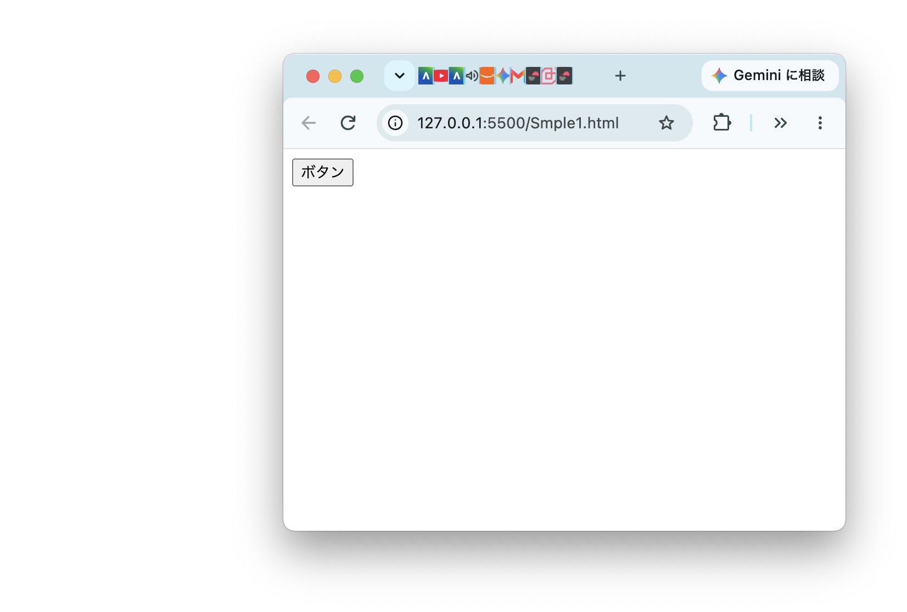
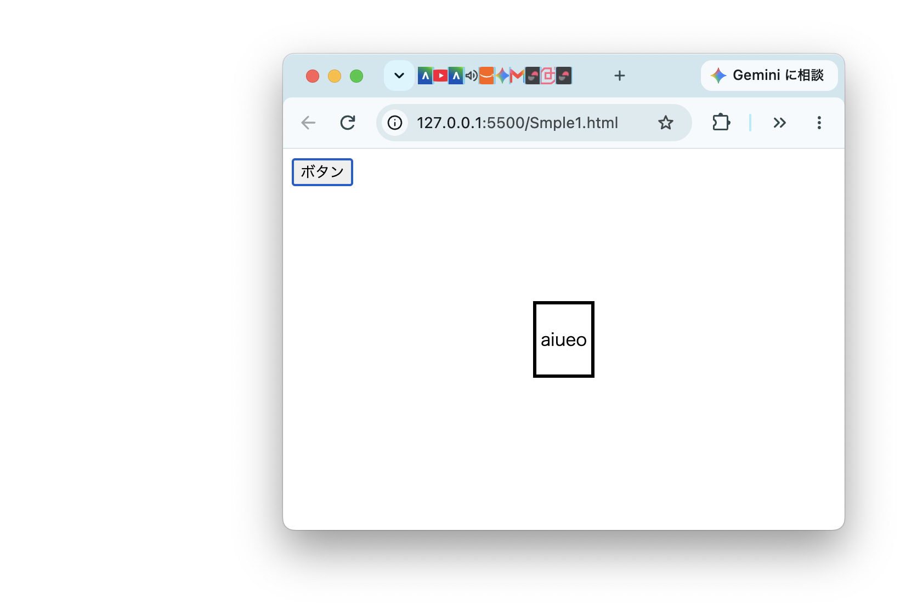
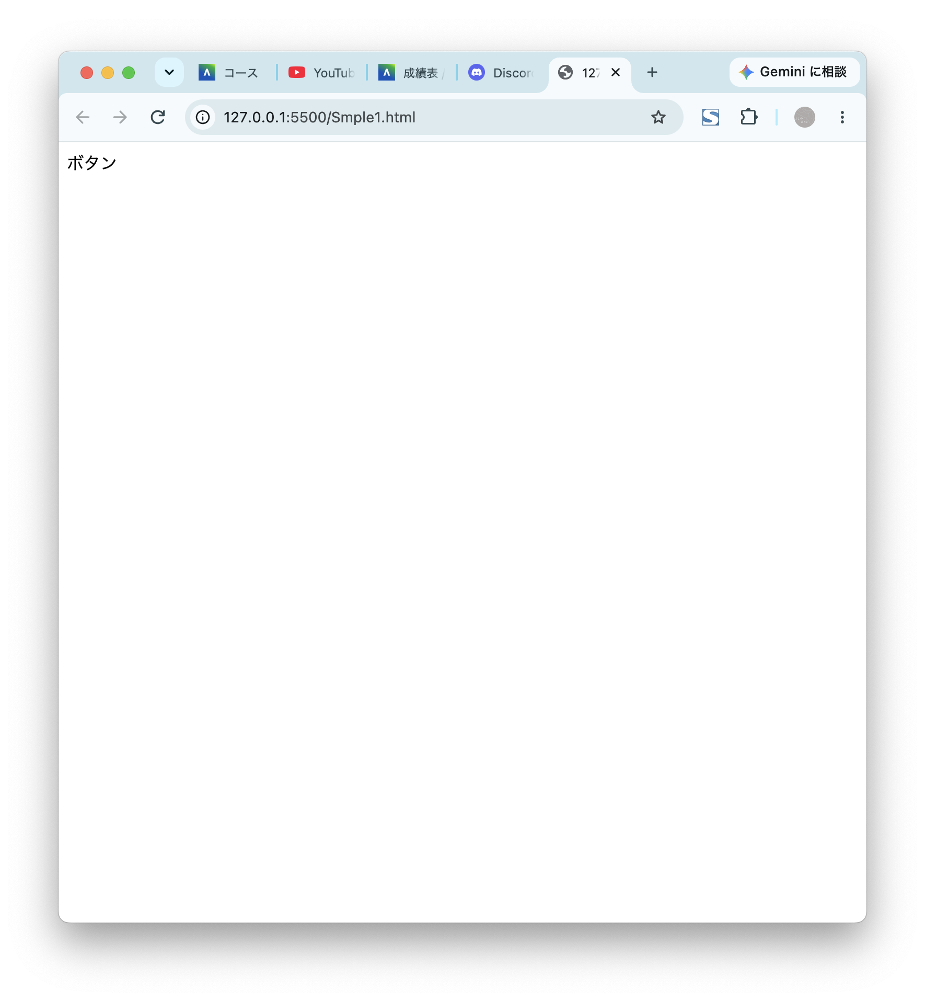

 .   popoverについて
## popoverとは
クリックするとブラウザ内で表示されるウィンドみたいなもの

### ↓

```
       <button popovertarget="view">ボタン</button>
       <div id="view" popover>
        <p>aiueo</p>
       </div>
```


#### 基本的にbuttonタグに対して有効です
次のようにaタグで囲っても何も起きません
```
       <a popovertarget="view">ボタン</a>
       <div id="view" popover>
        <p>aiueo</p>
       </div>
```


### ↓


### javascirptを使用して制御
```
        d1=document.querySelector('#view');
        //表示
        d1.showPopover();
        //非表示
        d1.hidePopover();
```